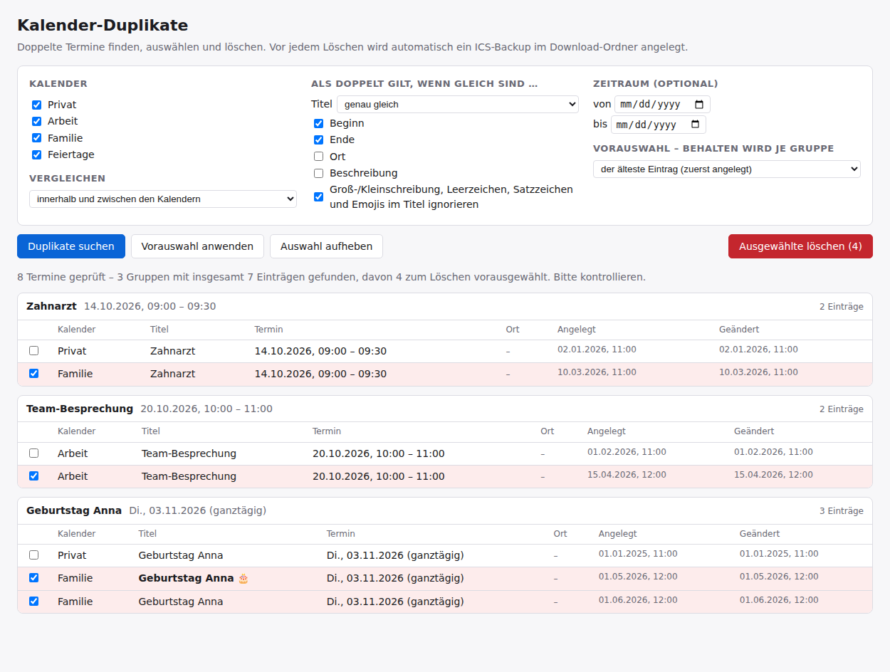

# Kalender-Duplikate

Ein Thunderbird-Add-on, das doppelte Kalendertermine findet – auch zwischen mehreren Kalendern –, sie gruppiert anzeigt und die ausgewählten löscht, mit automatischem ICS-Backup.

🇬🇧 [English version](README.md)



## Funktionen

- Vergleichsmodi: *innerhalb und zwischen den Kalendern*, *nur innerhalb jedes Kalenders*, *nur zwischen verschiedenen Kalendern* (z. B. nach einem doppelten Import).
- Titelvergleich: *genau gleich*, *mindestens n gemeinsame Wörter* (Füllwörter wie „der“, „und“, „am“ zählen nicht – findet z. B. „Zahnarzt Dr. Maier“ und „Termin Dr. Maier Zahnarzt“) oder *egal* (nur Datum/Uhrzeit vergleichen).
- Weitere Felder, die übereinstimmen müssen: Beginn, Ende, Ort, Beschreibung; optionaler Zeitraum; Groß-/Kleinschreibung, Leerzeichen, Satzzeichen und Emojis im Titel ignorieren.
- Vorauswahl je Gruppe: den ältesten, den zuletzt geänderten oder den Eintrag im zuerst gelisteten Kalender behalten. Schreibgeschützte Kalender werden berücksichtigt.
- Warnungen bei Serienterminen und bei Gruppen, in denen alle Einträge markiert sind.
- Vor dem Löschen wird ein ICS-Backup aller betroffenen Termine im Download-Ordner gespeichert.
- Deutsche und englische Oberfläche (je nach Thunderbird-Sprache). Arbeitet offline, sendet keine Daten.

## Installation

- Über **addons.thunderbird.net**: *Kalender-Duplikate* suchen und *Zu Thunderbird hinzufügen* klicken. Updates kommen dann automatisch.
- Aus einer Datei: `.xpi` aus den [Releases](../../releases) laden, dann in Thunderbird *Add-ons und Themes → ⚙ → Add-on aus Datei installieren …*.

Benötigt Thunderbird 128 bis 158. Entwickelt und getestet unter Windows.

Nach der Installation gibt es die Schaltfläche *Duplikate* in der Symbolleiste (in allen Bereichen, auch im Kalender) und einen Eintrag im Menü *Extras* (mit der **Alt**-Taste einblenden, falls die Menüleiste versteckt ist).

## Bedienung

1. Kalender, Vergleichsmodus und die Felder wählen, die übereinstimmen müssen.
2. **Duplikate suchen** klicken. Die Duplikate erscheinen gruppiert; je Gruppe bleibt ein Eintrag laut Vorauswahl stehen, die anderen sind angehakt.
3. Auswahl prüfen und **Ausgewählte löschen** klicken.

Achtung: Ist *derselbe* Google-Kalender zweimal abonniert, das überzählige Abo entfernen – das Löschen von „Duplikaten“ würde die Termine auf dem Server löschen.

## Funktionsweise

Thunderbird bietet noch keine offizielle Kalender-Schnittstelle für Add-ons. Dieses Add-on nutzt deshalb den veröffentlichten **Calendar-API-Entwurf** von Thunderbird (Ordner `src/experiments/calendar`, unveränderte Kopien aus dem Thunderbird-Projekt, Lizenz MPL 2.0). Die gesamte Logik des Add-ons steckt in `src/ui/`. Sobald Thunderbird die Kalender-API offiziell enthält, können die Entwurfsdateien einfach entfallen.

## Bauen

Reines JavaScript/HTML/CSS, kein Build-Schritt. Die `.xpi` erzeugt:

```
python build.py
```

Sie landet in `dist/`. Zum Testen lässt sich `src/manifest.json` auch über *Add-ons und Themes → ⚙ → Add-ons debuggen → Temporäres Add-on laden* laden.

## Mitmachen

Fehlermeldungen, Ideen und Übersetzungen sind willkommen – bitte ein [Issue](../../issues) anlegen. Die Texte stehen in `src/ui/i18n.js` (deutscher Text ist der Schlüssel, `EN` enthält Englisch) und `src/_locales/*/messages.json`.

## Datenschutz

Das Add-on sendet keine Daten. Siehe [PRIVACY.md](PRIVACY.md).

## Lizenz

[MIT](LICENSE) © 2026 Heinz Bundschuh.
Die Dateien in `src/experiments/calendar/` stammen aus dem Thunderbird-Projekt und stehen unter der [Mozilla Public License 2.0](src/experiments/calendar/LICENSE).
