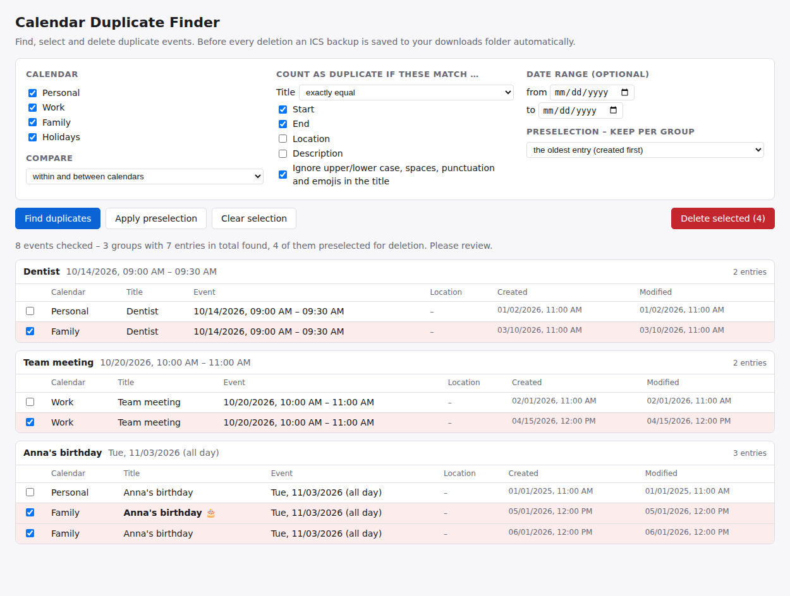

# Calendar Duplicate Finder (Kalender-Duplikate)

A Thunderbird add-on that finds duplicate calendar events – also across several calendars – shows them in groups and deletes the ones you select, with an automatic ICS backup.

🇩🇪 [Deutsche Version](README.de.md)



## Features

- Compare modes: *within and between calendars*, *only within each calendar*, *only between different calendars* (e.g. after importing a calendar twice).
- Title comparison: *exactly equal*, *at least n common words* (filler words like “the”, “and” do not count – finds e.g. “Dentist Dr. Maier” and “Dr. Maier dentist appointment”) or *ignore title* (compare date/time only).
- Further fields that must match: start, end, location, description; optional date range; ignore upper/lower case, spaces, punctuation and emojis in titles.
- Preselection per group: keep the oldest entry, the most recently modified one, or the one in the calendar listed first. Read-only calendars are respected.
- Warnings for recurring events and for groups where every entry is selected.
- Before deleting, an ICS backup of all affected events is saved to your downloads folder.
- English and German user interface (following Thunderbird's language). Works offline, sends no data.

## Installation

- From **addons.thunderbird.net**: search for *Kalender-Duplikate* and click *Add to Thunderbird*. Updates then arrive automatically.
- From a file: download the `.xpi` from the [releases](../../releases), then in Thunderbird open *Add-ons and Themes → ⚙ → Install Add-on From File…*.

Requires Thunderbird 128 up to 158. Developed and tested on Windows.

After installing there is a *Duplicates* button in the toolbar (in all spaces, including the calendar) and an entry in the *Tools* menu (press **Alt** if the menu bar is hidden).

## Usage

1. Choose calendars, the compare mode and the fields that must match.
2. Click **Find duplicates**. Duplicates are grouped; one entry per group is kept according to your preselection, the others are ticked.
3. Check the selection and click **Delete selected**.

Warning: if the *same* Google calendar is subscribed twice, remove the extra subscription instead – deleting "duplicates" would delete the events on the server.

## How it works

Thunderbird does not yet ship an official calendar API for add-ons. This add-on uses Thunderbird's published **Calendar API draft** (folder `src/experiments/calendar`, unmodified copies from the Thunderbird project, licensed under MPL 2.0). All logic of the add-on itself lives in `src/ui/`. When Thunderbird includes the calendar API officially, the draft files can simply be removed.

## Building

Plain JavaScript/HTML/CSS, no build step. To create the `.xpi`:

```
python build.py
```

The file is written to `dist/`. For testing you can also load `src/manifest.json` via *Add-ons and Themes → ⚙ → Debug Add-ons → Load Temporary Add-on*.

## Contributing

Bug reports, ideas and translations are welcome – please open an [issue](../../issues). Texts live in `src/ui/i18n.js` (German text is the key, `EN` holds English) and `src/_locales/*/messages.json`.

## Privacy

The add-on sends no data anywhere. See [PRIVACY.md](PRIVACY.md).

## Licence

[MIT](LICENSE) © 2026 Heinz Bundschuh.
The files in `src/experiments/calendar/` come from the Thunderbird project and are under the [Mozilla Public License 2.0](src/experiments/calendar/LICENSE).
